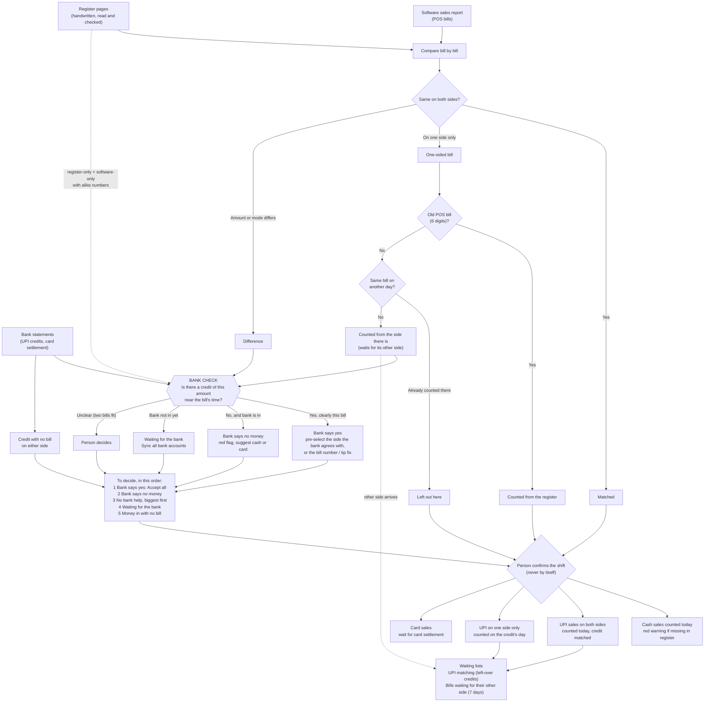

# Proposal: using bank credits to make Compare sales smarter

Design only, 3 Nov 2026. Nothing here is built. Questions for the owner are at the end.

## Where we are today

- **Compare sales** puts the software report next to the register, bill by bill. Bills on one side only are now
  decided by themselves (approved 3 Nov 2026); every other difference (amount, mode, both) waits for a person.
- **The bank is only used after the shift is confirmed.** UPI matching pairs each waiting UPI sale with a credit
  (same amount, within 20 / 60 / 180 minutes), and the explainer (step B1) then finds number typos, payments written
  wrong, bills paid in two goes, and UPI bills with no credit — and fixes them with recorded, reversible changes.
- So today a mistake that the bank could have shown on the evening of the shift is found a day later, and fixed
  the hard way (Fix the bill, Change the bills, Paid another way) on a locked shift.

**The idea in one line:** look at the bank *while* comparing, not only after. The bank becomes a third witness on
every UPI bill before anyone decides, and most of what the explainer does today moves to before confirming, where
the fix is a plain correction of the register page.

## What we can read from a credit

Each UPI credit (`bank_rows`, kind `upi_in`) has: amount, time posted (to the minute), which account it came into
(and so which register column it belongs to: "UPI XOXO" or "UPI Bank 2"), the payer's UPI ID, and the payer's note.
Card money comes once a day as one settlement (`card_settlement`), already less the card company's fee, so it can
only check a shift's card **total**, never one bill.

## Ground rules for every idea below

1. **"Bank is in" for a bill** = the bank lines of the account(s) for that UPI column reach at least **3 hours after
   the bill's time** (for a register-only bill with no time: 3 hours after the shift ends at 8 am). Before that, the
   bank can only say "yes, here is the money", never "no money came".
2. **One credit, one bill.** Credits are paired with bills the way UPI matching already pairs them: same amount, closest
   time first, each credit and each bill used once, and credits already matched (or strongly near a waiting sale of
   another day) are not used. A credit that fits two bills equally well (within 10 minutes of each other's distance)
   is **"unclear"**: shown, never used to decide.
3. **Evidence is not a match.** Using a credit to decide a bill does not match it and does not count money. Income is
   still counted from the decision when the shift is confirmed, and the credit is still matched afterwards (see idea 9
   for doing both in one step). So a credit can never count a bill twice.
4. **Strong** = within 20 minutes of the software's time. **Good** = within 60 minutes. Anything wider is only shown.
5. Every decision made from the bank says so in its note ("Bank: ₹1,240 into UPI XOXO at 9:42 pm, 3 min after the
   bill") and in the audit log, and a person can change it until the shift is confirmed. **Confirming stays with a
   person.**

## The ideas

### 1. Bank decides amount differences (software ₹X, register ₹Y, both UPI)

- **Catches:** a figure misread or miswritten in the register, a discount the POS has but the register forgot (or
  the reverse), a tip.
- **Rule:** one credit pairs with the bill (ground rule 2), it is **strong**, and its amount equals exactly one of:
  the software amount, the register amount after discount/tip, or the register bill amount before them.
  - equals the software amount → **Use software**;
  - equals the register's received amount → **Use register**;
  - equals the register's bill amount (before discount/tip) → **Use register, with "remove the discount/tip"**
    offered as a fix on the register page (today this is explainer card 2, after confirming).
  - no credit equals either, and the bank is in → stays for a person, with "No credit of either amount came in".
- **Stays for a person:** paid in two goes, paid together with other bills, one side cash/card, unclear credits,
  large discounts (over 20%, the existing rule).
- **Risk:** two bills of the same amount a few minutes apart pick each other's credit. Harmless to the total (same
  amount) but the wrong bill's note. Kept low by "strong only" and the unclear rule.
- **Data model:** none. Worked out each time Compare sales opens.

### 2. Bank decides mode differences (one side UPI, the other cash or card)

- **Catches:** payment written in the wrong column of the register, or the POS cashier picking the wrong mode.
- **Rule:**
  - a **strong** credit of the bill's amount pairs with it → the UPI side is right;
  - **no** credit of the amount within 3 hours, and the bank is in → the UPI side is wrong. If the other side says
    cash and the shift's cash is over by exactly this bill (the cash check), say so: that is very strong.
  - card vs cash (no UPI on either side) → the bank cannot help bill by bill; see idea 8.
- **Stays for a person:** anything not strong; "no credit" when the bank is not in yet.
- **Risk:** a payer who paid the right amount by UPI for a different bill. Low, because pairing is one-to-one across
  the whole shift.
- **Data model:** none.

### 3. Bank confirms one-sided bills are real

- **Catches:** today a one-sided UPI bill is counted only when its credit is matched (on the credit's day). With the
  bank looked at before confirming, Compare sales can show **"Bank has it"** next to it at once, and the credit is
  pre-chosen for matching.
  - Software-only UPI bill + strong credit → "Real sale, just not written in the register".
  - Register-only UPI bill + one credit of its amount in the shift → "Real sale, not in the POS — was a bill made?"
  - One-sided UPI bill with **no** credit once the bank is in → **red**, like a missing cash bill today: "No money
    came in for this bill."
- **Stays for a person:** what to do with the red ones.
- **Risk:** none to the books (it only adds a label); the rule for when it is counted does not change.
- **Data model:** none.

### 4. Bank picks the right bill number (half-bills and typos, before confirming)

- **Catches:** register 4721 and software 4712 shown as two one-sided bills (each counted once, so counted twice until
  someone notices).
- **Rule:** a register-only bill and a software-only bill of the same shift, numbers alike (existing `sameBillNo`, or
  1 digit wrong / swapped), **and** one credit that equals the register's received amount, within 60 minutes of the
  software bill's time → suggest "Register 4721 is bill 4712". The existing register-page bill-number suggestions
  (`suggestBills`) are ranked by this: a suggestion the bank backs goes first with "Bank agrees".
- **Fix:** before confirming it is just correcting the bill number on the register line (no Fix the bill needed).
  One click; the two one-sided rows become one compared bill.
- **Stays for a person:** always a click (a bill number is never changed by itself).
- **Risk:** two typos of similar numbers and amounts in one shift. Very rare; the person sees both bills.
- **Data model:** none.

### 5. Payment written under the wrong UPI column (UPI XOXO vs UPI Bank 2)

- **Catches:** the register writes the payment under UPI XOXO but the money went into a UPI Bank 2 account. Today
  UPI matching never offers such a credit (the column rule rejects it), so the bill waits forever.
- **Rule:** a waiting UPI bill has no credit in its own column's accounts, and exactly one strong credit of its amount
  is in the other column's accounts, not paired with anything else → suggest "Move the payment to UPI Bank 2".
- **Stays for a person:** the click.
- **Data model:** none (the column is already on the register payment).

### 6. Bill paid in two goes

- **Catches:** the register shows ₹2,000 but the guest paid ₹1,500 + ₹500.
- **Rule (as explainer card 3, moved earlier):** two or three credits from the **same payer UPI ID** within 30 minutes
  of each other and within 90 minutes of the bill, adding up exactly to the bill → suggest writing two UPI payments
  on the register line.
- **Data model:** none.

### 7. Money in with no bill on either side

- **Catches:** a sale nobody billed (no POS bill, no register line), or a bill missing from both.
- **Rule:** once the bank is in for the whole shift: a UPI credit in the shift (8 am to 8 am) that pairs with no bill of
  this shift or the shifts either side, is not a reversal or a card fee, is not fitted by a saved rule, and its payer is
  not a known party (supplier refund, owner transfer) → list it on Compare sales as **"Money in with no bill: ₹X at
  time, from payer"**. Total shown with the shift totals.
- **Stays for a person:** always. Actions link to what exists: "Unbilled F&B / Room" (books it as income), "Not a
  sale" (leave out with a reason), or "Find the bill".
- **Risk of double counting:** a late register page brings the bill later. So it is a **warning, not counted**, until
  a person books it, and booking checks again for a bill of that amount.
- **Data model:** none.

### 8. Card total check against the settlement

- **Catches:** card sales written as cash (or the reverse) across the shift.
- **Rule:** the next card settlement credit after the shift (S) against the shift's card total (C) by software and by
  register: fee = C − S. A side whose fee is between 0% and 2.5% of C "fits". If only one side fits, show which. Never
  decides a bill (the bank cannot say which bill).
- **Risk:** the card machine's day does not end at 8 am, so settlements mix two shifts. Noisy until the card company's
  daily email (phase 3 part 2) gives per-transaction detail. **Wait for that.**
- **Data model:** none now; per-transaction card data later needs tables.

### 9. Match the evidence credits when the shift is confirmed

- **What:** the credits used to decide bills (ideas 1–3) are already paired. Confirming could also match them in the
  same step, with a tick box "Also match the N credits the bank showed", so UPI matching only has the hard ones left.
- **Risk:** today "nothing matches by itself". Here the person confirming ticks it, the credit is marked matched so it
  cannot be used twice, and Unmatch works as today. Reopening a shift would need its matches undone first (today a
  matched sale blocks reopening).
- **Data model:** none strictly; a `bank_row_id` on the comparison (to remember exactly which credit was the evidence)
  would make it cleaner — **a data model change, needs approval**.

### 10. Put the decisions in the best order

Compare sales "to decide" list, top to bottom:

1. **Bank says** — differences the bank backs (ideas 1–2, 4–6): pre-selected, one button "Accept N bank-backed choices".
2. **Bank says no money** — red one-sided UPI bills and UPI bills with no credit (idea 3, 2).
3. **No bank help** — cash/card differences, biggest rupees first.
4. **Waiting for the bank** — UPI differences whose bank is not in yet: "Sync the bank first" button (Sync all exists).
5. Money in with no bill (idea 7), as a separate box.

A banner says whether the bank is in for this shift (the explainer already knows how to tell).

## Value for effort

| # | Idea | Value | Effort | Data model change |
|---|---|---|---|---|
| A | Bank evidence on each bill + "Accept N bank-backed" (ideas 1, 2, 3) | High: most UPI differences decided in one click | Medium: one pairing function reused from UPI matching, a chip per bill, one button | No |
| B | Order the list + "is the bank in" banner (idea 10) | Medium-high: the person starts with the easy clicks | Low | No |
| C | Explainer before confirming: bill number, tip/discount, two goes (ideas 4, 6, part of 1) | High: fixes become plain register corrections | Medium: logic exists in explain.ts; new actions edit the register page instead of a locked shift | No |
| D | Money in with no bill (idea 7) | Medium: catches unbilled sales | Low | No |
| E | Wrong UPI column (idea 5) | Medium-low (how often it happens is not known) | Low | No |
| F | Match on confirm (idea 9) | Medium: less work on UPI matching | Medium | Optional (needs approval) |
| G | Card settlement total check (idea 8) | Low until card emails come | Low, but noisy | Not now |

## Recommendation: build these first

1. **A — Bank evidence on each bill**, with bank-backed choices **pre-selected for a person to accept** (not decided by
   themselves), at first.
2. **B — Order the list and show whether the bank is in.** Cheap, and it makes A obvious to use.
3. **C — Explainer before confirming**, starting with the bill-number check (idea 4), the one that stops bills being
   counted twice.

After a week of real shifts, look at how often the person overrode a bank-backed choice. If almost never, let A decide
by itself like one-sided bills (owner's approval needed).

## Decisions needed from the owner

1. When the bank backs one side of a difference: **pre-select it for a person to accept (recommended)**, or decide it by
   itself like one-sided bills?
2. May "no money came in" (bank in, no credit of the amount within 3 hours) be used as evidence before confirming, e.g.
   to suggest "this was cash"? (Recommended: yes, as a suggestion only.)
3. "Money in with no bill": a **warning only (recommended)**, or should it stop the shift being confirmed until someone
   explains it?
4. Later: match the evidence credits when the shift is confirmed (idea 9)? If yes, with or without the new
   "which credit" field (a data model change)?

## Flowchart

